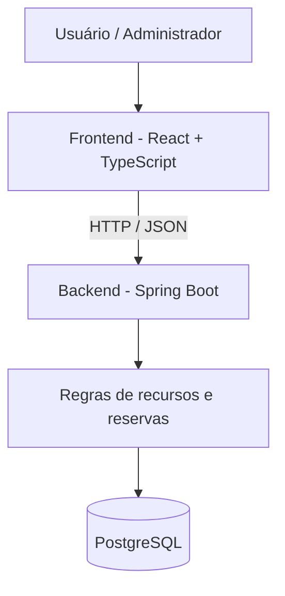

<h1 align="center">CampusReserva</h1>

<p align="center">
  Plataforma web para gerenciamento de reservas de espaços e recursos universitários.
</p>

<p align="center">
  <strong>Projeto de portfólio full-stack</strong> · <strong>Status: planejamento e estruturação</strong>
</p>

---

## Visão geral

O **CampusReserva** é uma proposta de aplicação para facilitar a reserva de **salas, laboratórios e equipamentos** em instituições de ensino. A ideia é centralizar a consulta de disponibilidade e o gerenciamento de solicitações em uma interface simples, com regras de negócio implementadas no servidor.

O projeto será desenvolvido de forma incremental como parte de um portfólio de engenharia de software, com ênfase em **backend, persistência de dados, segurança, testes e integração com frontend**.

> **Estado atual:** este repositório contém a apresentação e o planejamento inicial. A aplicação ainda **não está implementada**. O escopo e as decisões técnicas poderão evoluir durante o desenvolvimento.

## Problema que queremos resolver

Reservas feitas por mensagens, planilhas isoladas ou controles manuais dificultam a consulta de horários disponíveis e podem gerar conflitos. O CampusReserva busca oferecer um fluxo claro para:

1. Consultar os recursos disponíveis.
2. Selecionar um recurso, uma data e um intervalo de horário.
3. Solicitar uma reserva.
4. Receber a confirmação ou uma explicação de por que a reserva não pode ser realizada.
5. Consultar e cancelar reservas próprias, respeitando as regras estabelecidas.

## Funcionalidades planejadas

| Módulo | Funcionalidades propostas |
| --- | --- |
| Recursos | Cadastro e listagem de salas, laboratórios e equipamentos. |
| Disponibilidade | Consulta de horários e prevenção de reservas conflitantes. |
| Reservas | Solicitação, visualização de histórico e cancelamento. |
| Usuários | Autenticação e diferentes permissões de acesso. |
| Administração | Gerenciamento dos recursos e das reservas. |
| Qualidade | Validação de entradas, testes automatizados e documentação da API. |

O **primeiro objetivo** será entregar um fluxo mínimo de consulta e reserva com persistência em banco de dados, antes de ampliar as funcionalidades.

## Tecnologias previstas

| Camada | Tecnologias |
| --- | --- |
| Backend | Java, Spring Boot, Spring Data JPA e Spring Security |
| Banco de dados | PostgreSQL e Flyway |
| Frontend | React, TypeScript e Vite |
| Desenvolvimento local | Docker Compose |
| Testes | JUnit, Mockito e Testcontainers |
| Documentação da API | OpenAPI / Swagger |
| Integração contínua | GitHub Actions |

*As tecnologias estão planejadas, mas ainda não representam dependências instaladas ou funcionalidades implementadas.*

## Arquitetura proposta

A primeira versão seguirá um **monólito modular**, com responsabilidades separadas entre interface, API e banco de dados. A escolha prioriza simplicidade, facilidade de teste e clareza das regras de negócio.



A integridade das reservas, inclusive diante de requisições simultâneas, será tratada no backend e no banco de dados, e não apenas na interface.

## Estrutura do repositório

```text
campusreserva/
├── backend/             # Aplicação Java (a implementar)
├── frontend/            # Interface web (a implementar)
├── docs/
│   ├── requisitos.md    # Escopo e regras de negócio propostas
│   ├── arquitetura.md   # Organização e decisões técnicas iniciais
│   └── roadmap.md       # Etapas de desenvolvimento
├── .editorconfig
├── .gitignore
└── README.md
```

## Roadmap

- [x] Definir a visão e organizar a documentação inicial.
- [ ] Validar requisitos e regras de negócio do MVP.
- [ ] Criar a base do backend e a configuração do PostgreSQL.
- [ ] Implementar cadastro e consulta de recursos.
- [ ] Implementar reservas e proteção contra conflitos de horário.
- [ ] Adicionar autenticação e permissões.
- [ ] Construir a interface React integrada à API.
- [ ] Consolidar testes, CI e documentação de execução.
- [ ] Publicar uma versão demonstrável.

Acompanhe o detalhamento em [docs/roadmap.md](docs/roadmap.md).

## Documentação

- [Requisitos e critérios de aceitação](docs/requisitos.md)
- [Arquitetura inicial](docs/arquitetura.md)
- [Planejamento de entregas](docs/roadmap.md)

## Execução local

A aplicação ainda não possui uma versão executável. As instruções de instalação e execução serão adicionadas quando os módulos de backend e frontend forem criados.

---

**Desenvolvimento:** [Enzo Lauxen Stefanello](https://github.com/Enzo-Stefanello) · [LinkedIn](https://www.linkedin.com/in/enzo-lauxen-stefanello/)
