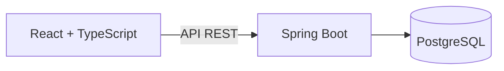
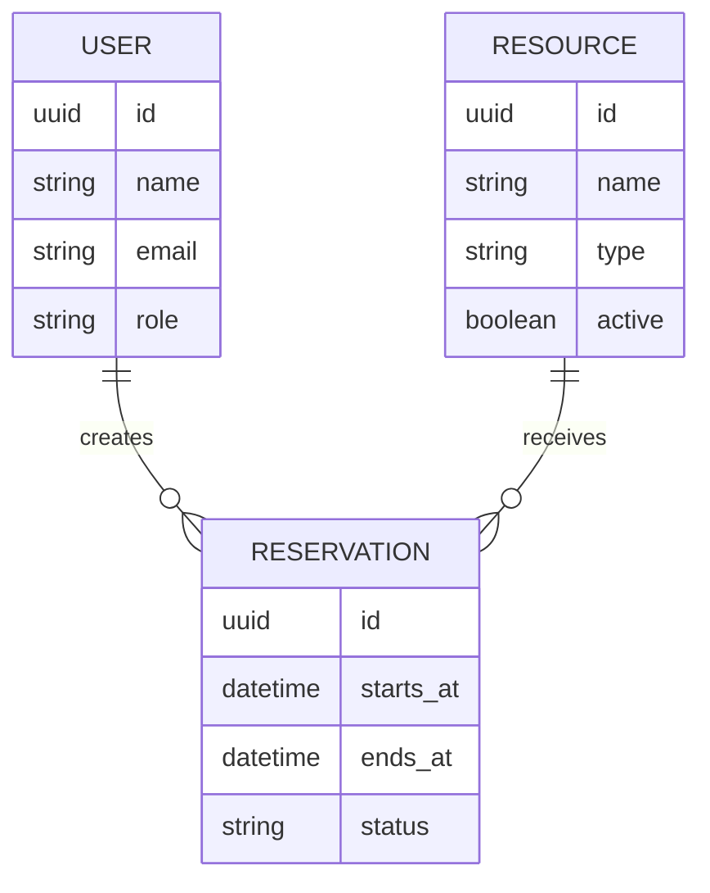

# Arquitetura inicial

> Proposta de arquitetura. Nenhum módulo está implementado nesta fase.

## Visão de alto nível

### Frontend

- Interface para consulta de recursos, disponibilidade e reservas.
- Responsável por interação, estado de apresentação e validações de usabilidade.
- Não é a fonte de verdade das regras de conflito.

### Backend

- API REST em Java com Spring Boot.
- Organização por módulos de domínio, começando por `resources`, `reservations` e `users` quando o código for criado.
- Regras de negócio explícitas em serviços ou componentes de domínio, evitando lógica concentrada em controllers.
- Autenticação e autorização introduzidas na etapa apropriada.

### Banco de dados

- PostgreSQL para persistir usuários, recursos e reservas.
- Migrações versionadas via Flyway.
- Estratégia de integridade e concorrência definida e testada antes de liberar o fluxo de reserva.

## Decisão inicial: monólito modular

O CampusReserva começará como uma aplicação backend única, organizada em módulos internos. Essa escolha facilita o desenvolvimento incremental, os testes e a compreensão da arquitetura, sem o custo operacional inicial de microsserviços.

## Modelo conceitual preliminar

O modelo ainda **não** define todas as colunas, índices ou tipos definitivos. Eles serão validados durante a etapa de modelagem de dados.

## Qualidade planejada

- Testes unitários para regras de disponibilidade e reserva.
- Testes de integração para persistência e cenários concorrentes.
- Verificações automáticas no GitHub Actions quando a aplicação estiver configurada.
- Configurações por ambiente, sem credenciais versionadas.
- Documentação da API via OpenAPI.

## Pontos em aberto

1. Identificar reservas válidas, expiradas e canceladas.
2. Escolher a estratégia de proteção contra reservas concorrentes (transações, locking e/ou restrições de banco), com testes reais.
3. Definir autenticação (sessão/cookies ou tokens), considerando o modelo de deploy.
4. Definir fuso horário e representação consistente dos instantes no banco e na API.
5. Especificar como o frontend receberá erros de validação e conflitos.
