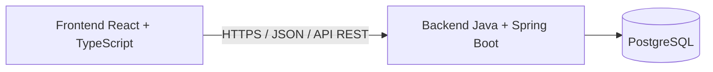
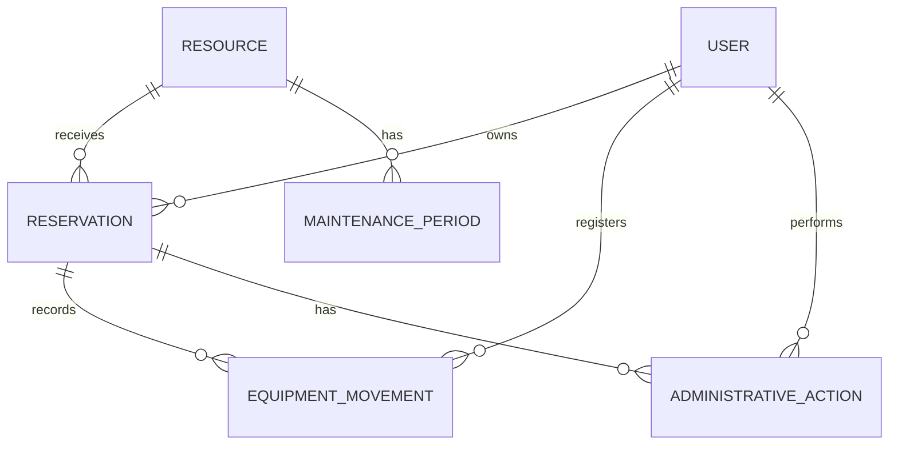

# Arquitetura do CampusReserva

> **Status:** arquitetura conceitual alinhada ao MVP acadêmico; **nenhuma implementação ou validação técnica foi executada**.  
> **Fontes funcionais:** [requisitos](./requisitos.md) e [RN-01 a RN-20](./regras-de-negocio.md). As regras aprovadas prevalecem sobre exemplos deste documento.

## 1. Objetivo arquitetural

Construir uma aplicação full-stack de portfólio que demonstre domínio de Java, Spring Boot, persistência relacional, segurança, integridade transacional e testes, sem adotar complexidade operacional desnecessária.

O MVP abrange **laboratórios** e **equipamentos físicos individualizados**. Salas de aula convencionais, integrações institucionais, notificações e microsserviços não fazem parte do primeiro escopo.

## 2. Visão de alto nível

- **Frontend:** apresenta recursos, disponibilidade, reservas e operações permitidas a cada perfil. Validações de interface ajudam na experiência, mas não substituem a validação no servidor.
- **Backend:** autentica, autoriza, aplica as RN-01 a RN-20, controla transições e verifica invariantes antes de persistir alterações.
- **PostgreSQL:** armazena usuários, recursos, reservas, movimentações, manutenções e histórico administrativo, com restrições e transações compatíveis com as regras.
- **Flyway:** controla migrações versionadas do esquema.
- **Docker Compose:** ambiente local reproduzível, conforme versões a confirmar.

## 3. Estilo: monólito modular

Uma aplicação Spring Boot com módulos internos orientados por responsabilidades, **sem serviços independentes nem comunicação distribuída**.

### Fronteiras conceituais propostas

| Área | Responsabilidade |
|---|---|
| **Identidade e acesso** | Cadastro público como estudante, autenticação, autorização, perfis e provisionamento seguro do primeiro administrador. |
| **Recursos** | Cadastro e consulta de laboratórios e equipamentos individuais, ativação/desativação e manutenção. |
| **Reservas** | Agendamento, disponibilidade temporal, cotas, períodos acadêmicos, cancelamentos, transições, expiração e análise administrativa. |
| **Movimentações de equipamentos** | Retirada e devolução físicas registradas por administrador, verificação de atrasos e retificações limitadas. |

Estas são **fronteiras de responsabilidade, não uma exigência de quatro projetos ou de quatro camadas artificiais**. A estrutura definitiva de pacotes e classes será escolhida ao implementar cada funcionalidade.

### Divisão de responsabilidades dentro do backend

- **Controllers REST:** recebem solicitações, aplicam validações básicas de formato e retornam respostas HTTP.
- **Aplicação / serviços:** coordenam casos de uso, autorização, transações e chamadas entre responsabilidades.
- **Domínio:** concentra regras e validações de estados, intervalos, disponibilidade, cotas e permissões específicas.
- **Persistência:** acessa o PostgreSQL por repositórios Spring Data JPA e migrações Flyway.

Evitar concentrar regras importantes em controllers ou no frontend. Também evitar abstrações genéricas antes de existir necessidade concreta.

## 4. Modelo conceitual

**Entidades e relacionamentos acima são conceituais.** Não fixam quantidade de tabelas, nomes Java, cardinalidades exatas de implementação nem estratégia de herança JPA.

Requisitos do modelo:

- Uma reserva pertence a um titular e referencia um único recurso.
- Cada equipamento físico possui identificação única e histórico próprio, mesmo quando existe outro do mesmo modelo (RN-18).
- Laboratórios e equipamentos possuem comportamentos temporais e estados específicos.
- Movimentações registram responsável administrativo, instantes efetivos e momento de registro.
- Manutenções preservam início, liberação manual, motivo e responsável.
- Retificações preservam valor anterior, valor corrigido, justificativa e responsável (RN-20).
- Reservas afetadas mantêm período e histórico originais mesmo quando não bloqueiam a disponibilidade (RN-13).

## 5. Ciclos de vida

**Laboratórios:** `CONFIRMADA` e `CANCELADA`. A passagem do horário não cria conclusão automática.

**Equipamentos:** `CONFIRMADA`, `EMPRESTADA`, `DEVOLVIDA`, `CANCELADA`, `EM_ANALISE` e `ENCERRADA`.

Motivos de `ENCERRADA`: `NAO_RETIRADA`, `NAO_ATENDIDA` e `ANALISE_INCONCLUSIVA`.

- `EM_ANALISE` não ocupa cota nem calendário, mas não autoriza entrega física.
- Atraso é condição calculada de empréstimo aberto, não estado adicional.
- Transições finais não são reabertas pelo fluxo comum.
- A máquina de estados, suas condições e os limites de tempo são definidos em [regras-de-negocio.md](./regras-de-negocio.md).

## 6. Disponibilidade e integridade

Antes da confirmação, o backend considera **em conjunto**:

1. Permissão do usuário e elegibilidade do recurso.
2. Horário e duração permitidos, antecedências e fuso institucional.
3. Conflitos com reservas bloqueantes do mesmo recurso.
4. Cota do usuário e impedimentos por empréstimos atrasados.
5. Manutenção, desativação e condições físicas relevantes do equipamento.

Uma consulta de disponibilidade é informativa; **a confirmação exige validação novamente na mesma operação transacional**. Não se aceita dupla reserva ou violação de cota em requisições concorrentes.

A estratégia específica de proteção contra concorrência (bloqueio transacional, restrições do PostgreSQL ou combinação) **ainda será escolhida mediante testes de integração**. Não afirmar garantia de concorrência antes da validação.

Reservas consecutivas e procedimentos de desativação com reservas futuras permanecem casos de borda explicitados nos requisitos.

## 7. Segurança e autenticação

### Decisão arquitetural aprovada: sessão HTTP com cookie seguro

**Status:** aprovada na Fase 0; **não implementada ou testada**.

**Contexto:** o CampusReserva é uma aplicação web acadêmica com React no navegador, API Spring Boot, um backend inicialmente único e três perfis de acesso. Não há exigência de clientes móveis, provedores externos de identidade ou microsserviços.

**Decisão:** utilizar **autenticação stateful por sessão HTTP**, com **Spring Security** gerenciando o contexto de segurança; o navegador mantém um cookie que identifica a sessão, sem armazenar credenciais ou autorizações como fonte confiável do lado do cliente. **Não utilizar JWT próprio para autenticação no MVP.**

#### Fluxo esperado

1. Usuário envia credenciais ao endpoint de login, sob HTTPS na implantação.
2. O backend valida as credenciais, aplica proteções de autenticação e estabelece a sessão.
3. O navegador recebe um cookie de sessão protegido. A cada requisição, o servidor identifica a sessão autenticada e aplica a autorização do perfil e as regras de negócio.
4. O logout **invalida a sessão no servidor** e limpa o contexto de segurança; o navegador deixa de utilizar a identificação de sessão.
5. Após expiração ou logout, operações protegidas exigem nova autenticação.

#### Requisitos de segurança da solução

- **Cookie de sessão:** `HttpOnly` para impedir leitura direta por JavaScript; `Secure` no ambiente HTTPS; política `SameSite` compatível com a hospedagem. `SameSite=Lax` é a opção inicial recomendada para implantação na mesma origem, sujeita a validação prática.
- **Transporte:** HTTPS obrigatório em produção. Ambiente local poderá usar `localhost` e configuração apropriada de desenvolvimento, sem enfraquecer as exigências de produção.
- **CSRF:** proteção **habilitada** nas requisições que alteram estado, incluindo login e logout conforme a estratégia escolhida. O frontend React deverá obter e enviar o token CSRF da forma suportada pelo Spring Security para SPA, inclusive após mudanças de sessão; **não confundir cookie de sessão `HttpOnly` com o mecanismo de disponibilização do token CSRF ao frontend**.
- **CORS e origem:** preferir **React e API na mesma origem** na implantação (por exemplo, frontend em `/` e backend em `/api`), reduzindo a necessidade de credenciais cross-origin; usar proxy local de desenvolvimento se apropriado. Caso sejam necessárias origens distintas, revisar CORS, cookies e CSRF antes de publicar.
- **Sessão:** preservar a proteção contra fixação de sessão oferecida pelo Spring Security; expirar sessões inativas e tratar autenticação ausente/expirada com respostas coerentes para a API. **30 minutos de inatividade é um valor inicial proposto, ainda sujeito à definição durante a implementação**.
- **Armazenamento:** para o MVP com uma instância de backend, usar inicialmente sessões mantidas no servidor sem infraestrutura distribuída adicional; reinícios podem invalidar sessões. Não adicionar Redis ou Spring Session sem necessidade real.
- **Senhas:** armazenar somente hashes seguros, nunca senhas em texto puro; decidir configuração concreta de `PasswordEncoder` e validações na fase de implementação.
- **Autorização:** perfis `ESTUDANTE`, `PROFESSOR`, `ADMINISTRADOR` verificados no servidor; usuários comuns só acessam suas reservas, e operações de movimentação, manutenção, encerramento, retificação e alteração de perfil exigem autorização administrativa.
- **Cadastro e administração:** cadastro público não pode atribuir papéis privilegiados; primeiro administrador é provisionado por procedimento seguro, sem credenciais versionadas.
- **Segredos:** não versionar credenciais, senhas, chaves ou tokens.

#### Justificativa e alternativas

**Vantagens:** solução aderente ao Spring Security, logout com invalidação no servidor, menos decisões de ciclo de vida de tokens e infraestrutura proporcional ao MVP.

**Trade-offs:** autenticação stateful demanda gerenciamento de sessão, tratamento de cookies/CSRF e reconsideração do armazenamento de sessões se houver implantação com múltiplas instâncias.

**Alternativa não escolhida:** JWT Bearer; seria viável, mas exigiria decisões adicionais de armazenamento, renovação e revogação sem benefício claro para o atual escopo acadêmico.

#### Critérios de aceitação para implementação futura

- Login com credenciais válidas estabelece sessão; credenciais inválidas não autenticam.
- Sem sessão válida, endpoints protegidos rejeitam a operação.
- Usuário `ESTUDANTE` não executa ação de `PROFESSOR` ou `ADMINISTRADOR`.
- Usuário autenticado não acessa nem altera reservas privadas de terceiros.
- Logout invalida a sessão; sessão antiga não autoriza novas operações.
- Após expiração por inatividade, operações protegidas não são aceitas.
- Requisições de alteração sem token CSRF válido são rejeitadas.
- Frontend consegue obter/renovar token CSRF após login e logout segundo a configuração adotada.
- Cookies de sessão têm as proteções esperadas na implantação HTTPS.
- Não há segredos versionados no repositório.

**Referência técnica para implementação:** documentação oficial do Spring Security em gerenciamento de sessões, logout e CSRF para aplicações SPA. A configuração exata será testada com Spring Boot 4.1.2/Spring Security gerenciado pelo Boot.

## 8. Tempo e operações assíncronas

- Fuso institucional: `America/Sao_Paulo` (RN-15); instantes devem ser representados sem ambiguidade em backend, banco e API.
- Relógio do servidor é a referência das validações de antecedência, cancelamento e expiração.
- A expiração de reservas de equipamentos deve funcionar mesmo quando nenhuma rotina é executada no segundo exato do vencimento; o mecanismo técnico (verificação sob demanda e/ou tarefa agendada) está por decidir.
- Períodos de manutenção e registros físicos históricos exigem rastreabilidade temporal para verificar impedimentos que existiram durante a janela de retirada.

## 9. Qualidade e testes planejados

- **JUnit e Mockito:** regras isoladas de períodos, cotas, autorização e máquina de estados.
- **Testes de integração:** Spring Boot, PostgreSQL e migrações com dados reais de teste.
- **Testes concorrentes:** confirmar que duas requisições disputando o mesmo equipamento ou limite de cota não violam integridade.
- **Testes de segurança:** tentar acessar reservas de terceiros, cadastrar perfis privilegiados e executar ações administrativas sem autorização.
- **Testes de autenticação:** login válido/inválido, sessão expirada, logout com invalidação, cookies sob HTTPS e CSRF em alterações de estado.
- **Testes de regras temporais:** limites inclusivos/exclusivos, 5 e 30 minutos, 15 minutos de retirada, 336 horas, horário institucional.
- **GitHub Actions:** executar verificações automatizadas quando o projeto estiver implementado.
- **OpenAPI:** documentar a API real, não endpoints ainda inexistentes.

## 10. Decisões técnicas e limites pendentes

**Versões e decisões aprovadas (ainda não instaladas ou testadas localmente):**
- Java **25 LTS**, Spring Boot **4.1.2** e dependências Spring gerenciadas pelo Boot.
- Maven **3.9.x** com Maven Wrapper; PostgreSQL **18.6**; Flyway e módulos PostgreSQL gerenciados pelo Boot.
- Autenticação por **sessão HTTP com cookie seguro e proteção CSRF**; logout invalida sessão; origem única preferencial.

**Para definir ou verificar antes da implementação correspondente:**
- Compatibilidade das ferramentas e versões **no ambiente local**; seleção exata de dependências ao gerar o projeto.
- Procedimento concreto de provisionamento seguro do primeiro administrador, política de senha e expiração de sessão.
- Estrutura definitiva de tabelas/entidades, forma de representar instantes e restrições de banco.
- Estratégia transacional e de concorrência, validada com testes.
- Processo de expiração, tratamento de erros HTTP e exposição de regras no frontend.

**Casos operacionais do produto ainda em aberto** (sem alterar as RN aprovadas):
- Desativação de recurso que já possui reservas futuras.
- Limite temporal do cancelamento administrativo de laboratório depois do início.
- Movimentações registradas retrospectivamente ou realizadas fora do expediente.
- Eventual intervalo operacional entre reservas consecutivas.

## 11. Estado atual

A arquitetura descrita é **proposta/documentada, não implementada**. O roadmap define a sequência incremental de construção, com segurança antecipada em relação aos fluxos reserváveis.
